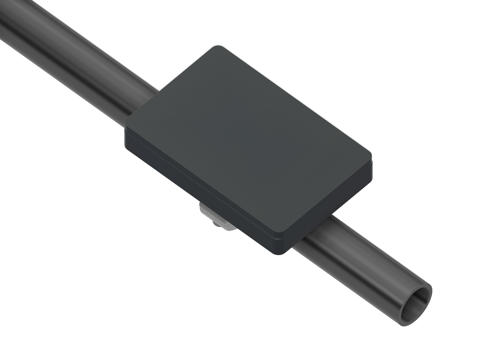
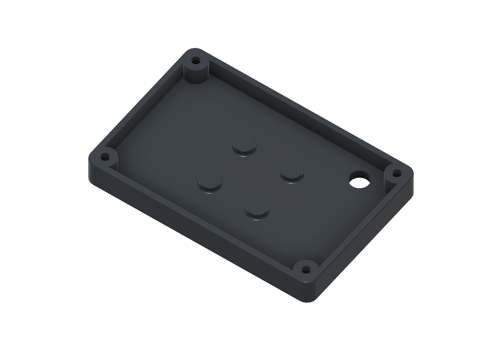
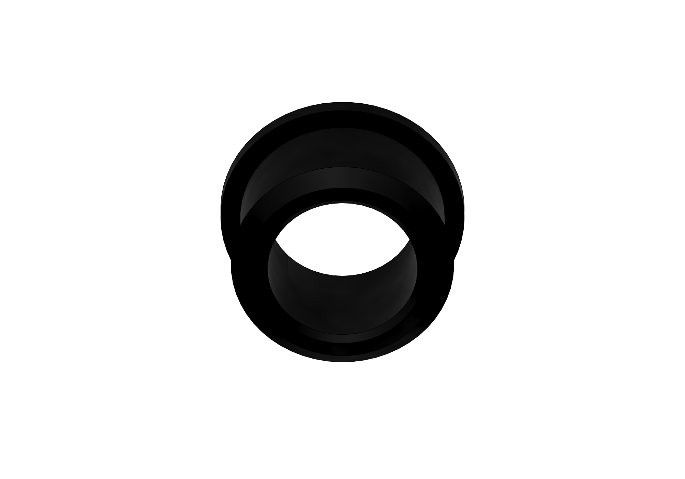
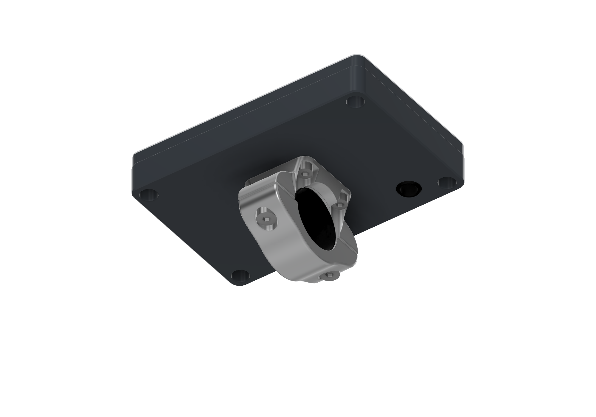
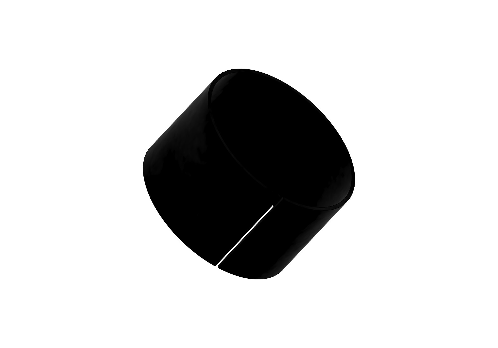
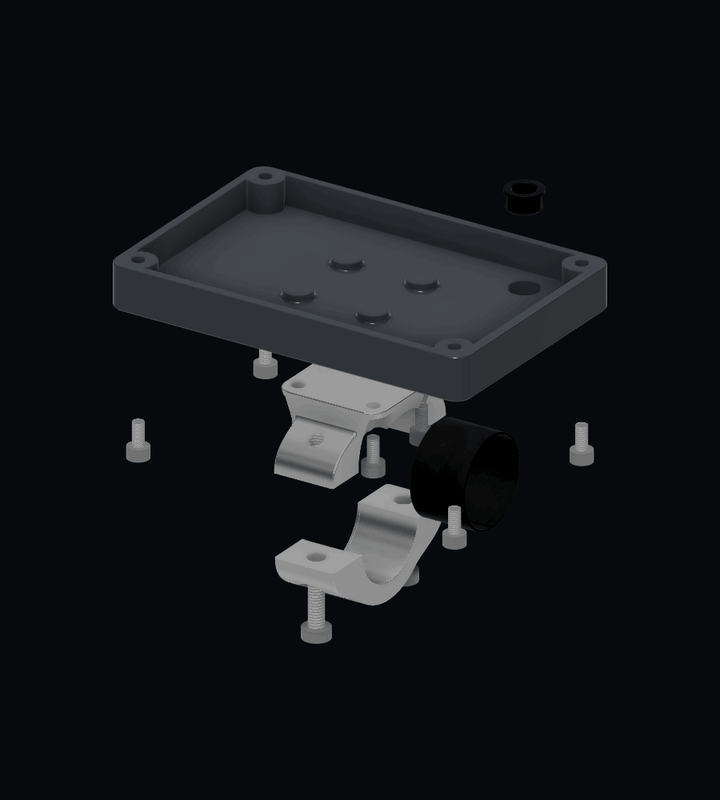

# GUITION 4.3-inch case and handlebar mount

Part of the [GUITION hardware guide](../../docs/hardware-guition-43.md).

A rear housing and handlebar mount for the GUITION JC4880P443C display, using the same aluminium saddle, lower clamp and split liner as the smaller Waveshare assembly. The source assembly shows the GUITION display mounted in landscape.

These are shaded CAD views using the source materials and appearances. The blank display, cover glass, cable jacket and handlebar are reference geometry. The handlebar is cropped in the mounted view to keep the case visible.

## Editable Fusion design

Download the [complete editable Fusion archive](../wheelie-fun-display-mounts.f3d). It contains the GUITION assembly, both Waveshare orientations, shared hardware, user parameters and the source timeline. All components are local, so the archive is F3D rather than an F3Z package.

The source GUITION display component is explicitly named `G02_REF_OEM_display_DEPTH_UNVERIFIED`. Its **5 mm module depth**, including **0.5 mm reference glass**, is an assumption in this CAD, not a verified vendor dimension. Check your actual module thickness, mounting threads, screw engagement, PCB/components, USB access and cable clearance before manufacturing the case. Firmware support for this board is described separately in the hardware guide.

## Download the parts

Each STEP contains one solid at its modelled size and carries its own length units. Import at 1:1 scale and honour the file units; dimensions in this guide are in millimetres. Reference electronics, cable, handlebar and standard fasteners are excluded.

| Part | STEP download | Source component / material |
|---|---|---|
| Rear housing | [rear-casing.step](rear-casing.step) | `G01_Rear_housing_PRINT_PROTO` / ABS Plastic |
| Upper saddle | [upper-saddle.step](upper-saddle.step) | `03_Upper_saddle_AL6061` / aluminium 6061 |
| Lower clamp cap | [lower-clamp-cap.step](lower-clamp-cap.step) | `04_Lower_cap_AL6061` / aluminium 6061 |
| Split liner | [rubber-liner.step](rubber-liner.step) | `HW_split_rubber_liner_0p5` / Rubber |
| Cable grommet | [cable-grommet.step](cable-grommet.step) | `G03_Snap_grommet_TPU75A` / Rubber, nominal TPU75A designation |

The clamp files are machining geometry for the model's aluminium parts. No slicer profiles or machining toolpaths are supplied. Check fit with the actual printed material and cable; the generic Fusion Rubber material does not qualify a specific TPU formulation.

## Dimensions and hardware

| Feature | Nominal source dimension |
|---|---|
| Housing outside width × height | 95 × 63 mm |
| Housing overall depth, including rear pad | 11.2 mm |
| Frame corner radius / wall parameter | 4 / 2.4 mm |
| Reference display footprint | 94.5 × 62 mm |
| Reference display depth, unverified | 5 mm, including 0.5 mm glass |
| Display screw pattern | 84.5 × 52.5 mm |
| Display screw head recess diameter / retaining web | 6.4 / 2 mm |
| Case-to-saddle mounting pitch | 20 × 20 mm |
| Handlebar diameter | 22.225 mm (7/8 inch) |
| Clamp bore / width | 23.225 / 16 mm |
| Liner wall / retained width / installation split | 0.5 / 14.3 / 0.5 mm |
| Cable jacket OD / casing hole | 6 / 7.8 mm |
| Grommet bore / barrel OD / panel grip | 5.8 / 7.9 / 3.8 mm |
| Grommet inner / outer flange OD | 9.4 / 8.6 mm |

The model contains the following hardware per GUITION assembly:

- Eight M3 × 6 ISO 4762 socket-head screws: four for the case-to-saddle joint and four reference display screws.
- Four M3 heat-set inserts, nominal 5 mm OD × 4 mm long, for the case-to-saddle joint.
- Two M4 × 12 DIN 7984 low-head socket screws for the handlebar clamp.
- One split rubber liner and one one-piece cable grommet.

The four display screws use the model's `GDisplayScrewLength_REF` parameter; their 6 mm length and thread compatibility must be checked against the real display. The upper saddle's 3.3 mm M4 tap-drill holes still require the appropriate tapping operation; STEP geometry does not provide threads or toolpaths.

## Housing and wiring

1. Verify the real display against the source's reference envelope and screw pattern. Check component and connector access before committing to a finished housing.
2. Prepare the case and fit its four M3 heat-set inserts. Test the saddle mounting screws for engagement without contact with the display or wiring.
3. Thread the cable through the **one-piece, unsplit grommet** before attaching any connector too large for its 5.8 mm bore. The 6 mm cable dimension is the outside jacket diameter, not an individual conductor.
4. Feed the cable through the case opening and seat the grommet from inside. The **larger 9.4 mm flange remains inside**, the smaller 8.6 mm flange outside, and the 3.8 mm panel stack sits in its retaining groove. Check both lips are seated without folding.
5. Route the wiring clear of the display, corner seats, insert bosses and mounting screws. Fit the display using its four verified screws from underneath; the source shows M3 × 6 reference screws on the 84.5 × 52.5 mm pattern.
6. Fasten the housing to the upper saddle with four M3 × 6 screws, keeping the cable free of the joint.

The grommet fit has not been qualified for a particular print, cable pull load or water-ingress rating. Check retention and any required sealing on the completed assembly.

## Clamp and split liner

Open the liner's **0.5 mm longitudinal split** and wrap it around the bar without removing the grips. The split extends through the 0.5 mm wall and full 14.3 mm width. Seat the liner between the clamp's retaining lips, fit the lower cap and install its two M4 screws. Confirm the display and cable remain clear throughout the required handlebar and steering movement.

## Assembly animation

The animation shows how the parts fit, rather than prescribing a fastening or machining sequence. The handlebar, reference cable and entire reference display, including glass, are hidden. Both the display screws and clamp fasteners approach from underneath; the grommet seats into the case from inside. [View the static exploded image](../../docs/images/guition-43-exploded.png).

## Orientation

The CAD includes one GUITION landscape assembly. Its square 20 × 20 mm case-to-saddle pattern also permits a 90° change in case orientation, subject to checking the larger display's cable and mechanical clearance. A separate GUITION portrait assembly is not posed in this source.

Set **Settings > Orientation** to match the physical installation. The firmware supports 0°, 90°, 180° and 270° with matching touch coordinates.

## Source and updates

Exported from **Wheelie Fun Display - Waveshare 2.06**, saved Fusion version **17**, with no unsaved changes, on **8 November 2026**. Despite its historical document name, this source now contains both display families. STEP exports preserve solid geometry, while the shared F3D retains the editable source design.

These project CAD exports use the repository's [GPL-3.0 license](../../LICENSE).
