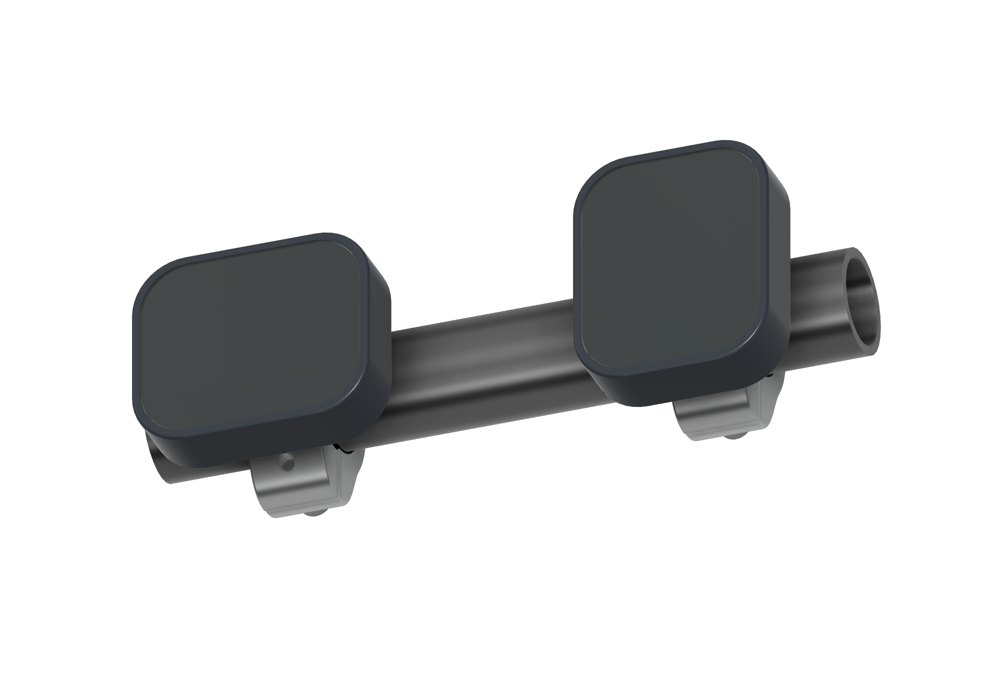
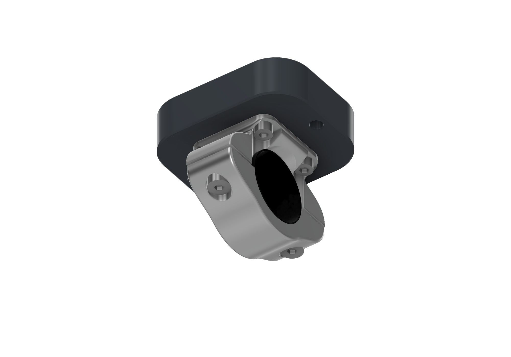
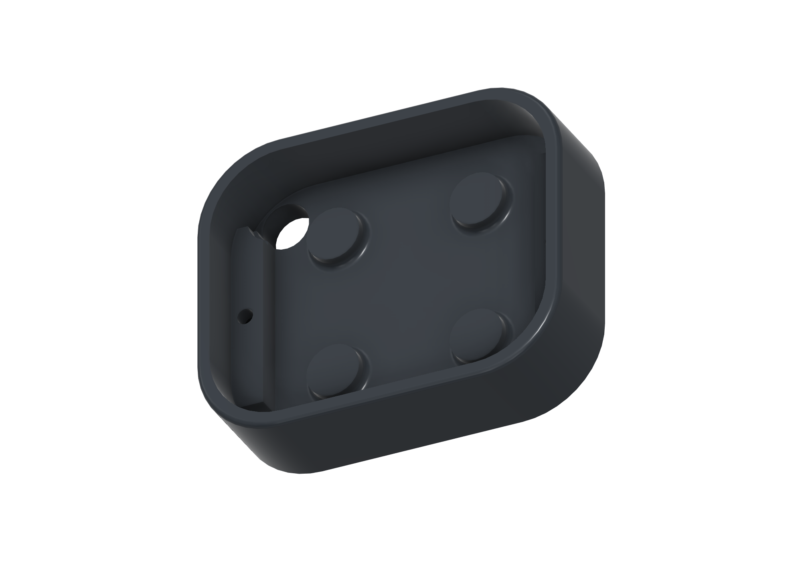

# Waveshare 2.06 casing and handlebar clamp

A compact casing and split handlebar clamp for the Waveshare ESP32-S3 Touch AMOLED 2.06 module. The Fusion assembly shows portrait and landscape installations of the same custom parts.

These are shaded CAD views of the current design. Display glass and the handlebar are reference geometry; the screen is shown blank.

## Editable Fusion design

Download the [complete Fusion archive](wheelie-fun-display-waveshare-206.f3d) to edit the assembly, user parameters and feature timeline. It includes both mounting orientations, standard hardware and the reference display and handlebar components.

This is an **F3D** archive because all components are local to one Fusion design. **F3Z** is Fusion's package format for designs with external linked references; this design does not need that container. See [Autodesk's archive format guide](https://help.autodesk.com/view/fusion360/ENU/?caas=caas%2Fsfdcarticles%2Fsfdcarticles%2FHow-to-make-a-local-archive-back-up-file-in-Fusion-360.html).

## Download the parts

Each STEP file contains one solid component at its modelled size, in millimetres. Import at 1:1 scale. Standard fasteners, reference display geometry and the handlebar are excluded.

| Part | STEP download | Model designation |
|---|---|---|
| Rear casing | [rear-casing.step](rear-casing.step) | `01_Rear_body_PRINT` — printed shell |
| Upper clamp saddle | [upper-saddle.step](upper-saddle.step) | `03_Upper_saddle_AL6061` — aluminium 6061 |
| Lower clamp cap | [lower-clamp-cap.step](lower-clamp-cap.step) | `04_Lower_cap_AL6061` — aluminium 6061 |
| Split rubber liner | [rubber-liner.step](rubber-liner.step) | `HW_split_rubber_liner_0p5` — 0.5 mm wall |

The clamp parts are designated aluminium in the source model. The casing is the part designated for printing; no slicer profile or machining toolpaths are included.

## Portrait or landscape mounting

The same casing and clamp can be assembled in **portrait or landscape**. Rotate the casing 90° relative to the upper saddle before fastening it; the square 20 × 20 mm mounting pattern supports both orientations without different printed parts. The mounted view above shows both arrangements side by side.

On the display, open **Settings > Orientation** to match the UI to the physical mounting. The firmware cycles through **0°, 90°, 180° and 270°**, so either portrait or landscape direction is available. The layout and touch coordinates rotate together.

## Fit and assembly

The source model uses these nominal dimensions:

| Feature | Dimension |
|---|---|
| Casing outside width × height | 42 × 51 mm |
| Shell depth, before rear mounting pad | 10.5 mm |
| Display cavity width × height | 38.2 × 47 mm |
| Handlebar outside diameter | 22.225 mm (7/8 inch) |
| Rubber liner wall | 0.5 mm |
| Clamp bore, including liner | 23.225 mm |
| Clamp width along the handlebar | 16 mm |
| Casing-to-saddle mounting pitch | 20 × 20 mm |
| Cable bore | 6.5 mm |

The model shows the following hardware **per display assembly**:

- Four M3 × 6 ISO 4762 socket-head screws.
- Four M3 heat-set inserts, nominal 5 mm outside diameter × 4 mm long.
- Two M4 × 12 DIN 7984 low-head socket screws for the clamp.
- Two M2 × 5 countersunk display screws, modelled with a reference drive.
- One split rubber liner.

The upper saddle has modelled 3.3 mm M4 tap-drill holes; STEP geometry does not supply a machining or tapping operation. Confirm the actual display, insert fit, screw engagement and cable clearance before fabrication. The source display component is explicitly marked as reference geometry to verify, rather than a vendor-accurate manufacturing model.

## Clamp detail

The underside view omits the handlebar so the liner, split and fastener access are visible.

## Casing interior

## Source and updates

Exported from **Wheelie Fun Display - Waveshare 2.06**, Fusion document version **9**, on **7 November 2026**. These STEP files are solid exports; they do not retain the Fusion parameter timeline. Re-export affected parts when the source design changes and update the views and dimensions here.

These project CAD exports use the repository's [GPL-3.0 license](../../LICENSE).
