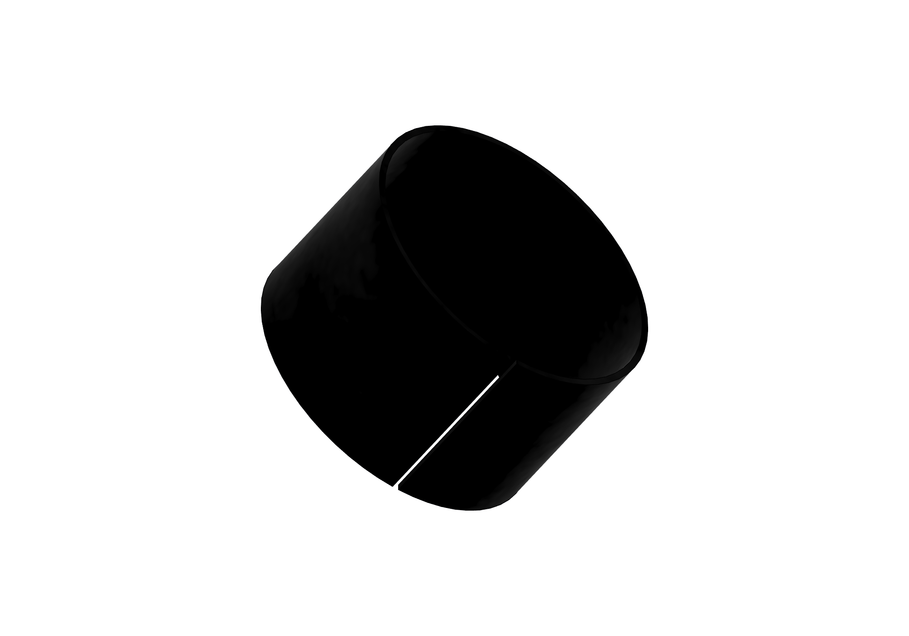
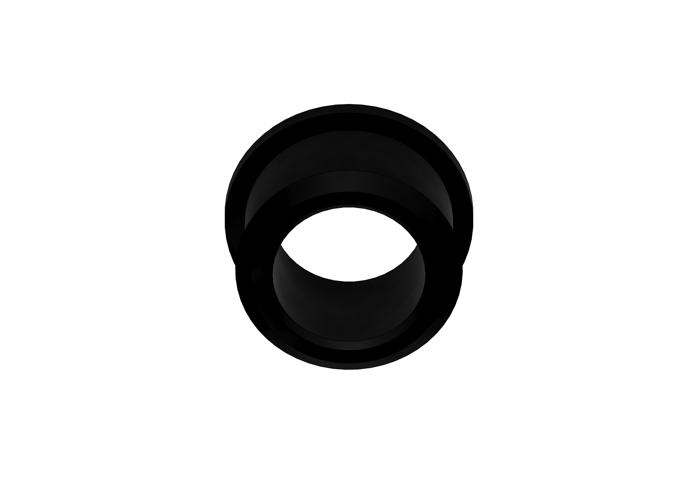
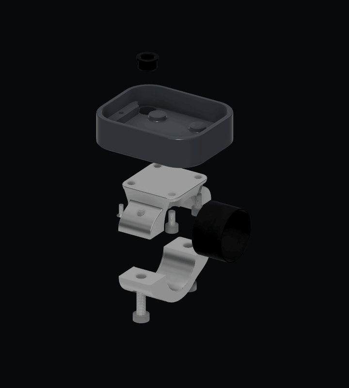

# Waveshare 2.06 casing and handlebar clamp

Part of the [Waveshare 2.06 hardware guide](../../docs/hardware-waveshare-206.md).

A compact casing and split handlebar clamp for the Waveshare ESP32-S3 Touch AMOLED 2.06 module. The Fusion assembly shows portrait and landscape installations of the same custom parts, including a flexible cable-entry grommet.

These are shaded CAD views of the current design. Display glass and the handlebar are reference geometry; the screen is shown blank. The long handlebar is cropped in the mounted view to keep the two cases visible.

## Before you make parts

1. Check your real display, mounting screws and connector clearance against the model.
2. Download the STEP files below for fabrication, or the Fusion archive near the end to edit the design.
3. Gather the listed fasteners and test-fit the casing, liner and cable grommet before final assembly.

## Download the parts

Each STEP file contains one solid component at its modelled size and carries its own length units. Import at 1:1 scale and honour the file units; dimensions in this guide are in millimetres. Standard fasteners, reference display geometry, the handlebar and the reference cable jacket are excluded. The casing export contains only the shell; its nested grommet is supplied separately.

| Part | STEP download | Model designation |
|---|---|---|
| Rear casing | [rear-casing.step](rear-casing.step) | `01_Rear_body_PRINT` — printed shell |
| Upper clamp saddle | [upper-saddle.step](upper-saddle.step) | `03_Upper_saddle_AL6061` — aluminium 6061 |
| Lower clamp cap | [lower-clamp-cap.step](lower-clamp-cap.step) | `04_Lower_cap_AL6061` — aluminium 6061 |
| Split rubber liner | [rubber-liner.step](rubber-liner.step) | `HW_split_rubber_liner_0p5` — 0.5 mm wall |
| Cable-entry grommet | [cable-grommet.step](cable-grommet.step) | `06_One_piece_grommet_TPU75A` — flexible TPU, nominal Shore 75A |

The clamp parts are designated aluminium in the source model. The casing and TPU grommet are intended for printing; no slicer profile or machining toolpaths are included.

## Portrait or landscape mounting

The same casing and clamp can be assembled in **portrait or landscape**. Rotate the casing 90° relative to the upper saddle before fastening it; the square 20 × 20 mm mounting pattern supports both orientations without different printed parts. The mounted view above shows both arrangements side by side.

On the display, open **Settings > Orientation** to match the UI to the physical mounting. The firmware cycles through **0°, 90°, 180° and 270°**, so either portrait or landscape direction is available. The layout and touch coordinates rotate together.

## Fit and assembly

The source model uses these nominal dimensions:

| Feature | Dimension |
|---|---|
| Casing outside width × height | 42 × 51 mm |
| Shell depth, before rear mounting pad | 10.5 mm |
| Display cavity width × height | 38.2 × 47 mm |
| Handlebar outside diameter | 22.225 mm (7/8 inch) |
| Rubber liner wall | 0.5 mm |
| Clamp bore, including liner | 23.225 mm |
| Clamp width along the handlebar | 16 mm |
| Retained liner width along the handlebar | 14.3 mm |
| Liner installation split | 0.5 mm, through the wall and full width |
| Liner retaining lip width / radial depth | 0.75 / 0.2 mm |
| Casing-to-saddle mounting pitch | 20 × 20 mm |
| Casing cable-entry hole | 7.8 mm |
| Cable jacket outside diameter | 6 mm |
| Grommet bore / barrel outside diameter | 5.8 / 7.9 mm |
| Grommet panel grip length | 3.8 mm |
| Grommet inner / outer flange diameter | 9.4 / 8.6 mm |

The model shows the following hardware **per display assembly**:

- Four M3 × 6 ISO 4762 socket-head screws.
- Four M3 heat-set inserts, nominal 5 mm outside diameter × 4 mm long.
- Two M4 × 12 DIN 7984 low-head socket screws for the clamp.
- Two M2 × 5 countersunk display screws, modelled with a reference drive.
- One split rubber liner.
- One one-piece cable-entry grommet in flexible TPU, nominal Shore 75A.

The upper saddle has modelled 3.3 mm M4 tap-drill holes; STEP geometry does not supply a machining or tapping operation. Confirm the actual display, insert fit, screw engagement and cable clearance before fabrication. The source display component is explicitly marked as reference geometry to verify, rather than a vendor-accurate manufacturing model.

## Split liner installation

The rubber liner has a **0.5 mm longitudinal split** through its full **0.5 mm wall** and **14.3 mm width**. Open the flexible liner at this seam and wrap it around the handlebar; the grips do not need to be removed. Seat it between the clamp's retaining lips before fitting the lower cap. Use flexible rubber for the liner so it can open around the bar.

## Cable grommet installation

The wiring entry uses a **one-piece snap-in grommet**, modelled for **TPU 75A** and a **6 mm outside-diameter cable jacket**. Download [cable-grommet.step](cable-grommet.step). The Fusion material is labelled Rubber; use the nominal TPU75A designation as the printing reference and test the actual material fit.

Its nominal **5.8 mm bore** provides 0.2 mm diametral interference with the cable jacket. Its **7.9 mm barrel** fits the casing's **7.8 mm hole**, with a **3.8 mm grip length** matching the modelled panel stack. The **9.4 mm inner flange** stays inside the casing; the **8.6 mm outer flange** sits outside. These are design dimensions, so test the printed fit with your actual material and cable before final assembly.

1. Print the grommet in flexible TPU appropriate to the model's nominal Shore 75A hardness. Check that the bore and retaining groove are open and free of print defects.
2. Thread the cable through the grommet before fitting any connector that cannot pass through the bore. This grommet is **not split**, so it cannot wrap around an already terminated cable like the handlebar liner wraps around the bar. The 6 mm dimension refers to the complete cable jacket, not an individual wire.
3. With the display still out of the casing, feed the cable through the casing opening. Seat the grommet from inside the casing, pushing the smaller outer flange through the hole until the panel sits in the groove between the flanges. Check both flanges are fully seated without a folded lip.
4. Route the wiring clear of the display, insert bosses, mounting screws and clamp. Leave enough slack for the chosen portrait or landscape orientation without pulling on PCB connections. Check the cable's bend and clamp clearance in that orientation before fastening the display.
5. Fit the display with the M2 screws approaching from underneath, then complete the casing-to-saddle and handlebar-clamp assembly shown below. Check the grommet stays seated as the wiring is gently moved.

The CAD fit has not been qualified for a particular printed material, cable pull load or water-ingress rating. Verify retention and any required sealing on the finished assembly.

## Assembly animation

The animation separates the components and brings them together to show how they fit. It is an assembly overview, rather than a fastening or machining sequence; the handlebar and reference display, including its cover glass, are omitted for visibility. The cable grommet moves independently into the casing, with its larger flange inside. The M2 display screws approach upward from underneath. [View the static exploded image](../../docs/images/waveshare-206-exploded.png).

## Clamp detail

The underside view omits the handlebar so the liner, split and fastener access are visible. The updated clamp has retaining lips for the narrower rubber liner, with 0.2 mm total axial clearance in its channel.

## Casing interior

## Editable Fusion design

Download the [complete Fusion archive](../wheelie-fun-display-mounts.f3d) to edit the assembly, user parameters and feature timeline. It includes both Waveshare mounting orientations, the GUITION case and mount, shared hardware, user parameters and reference displays, handlebar and cable jackets.

The F3D archive keeps the editable components, parameters and feature timeline together.

## Source and updates

These Waveshare parts and images remain from version 17. The shared Fusion archive includes the version-19 GUITION updates; Waveshare and shared mounting geometry are unchanged.

Exported from **Wheelie Fun Display - Waveshare 2.06**, Fusion document version **17** (saved source, with no unsaved changes), on **8 November 2026**. These STEP files are solid exports; they do not retain the Fusion parameter timeline. Re-export affected parts when the source design changes and update the views and dimensions here.

These project CAD exports use the repository's [GPL-3.0 license](../../LICENSE).
