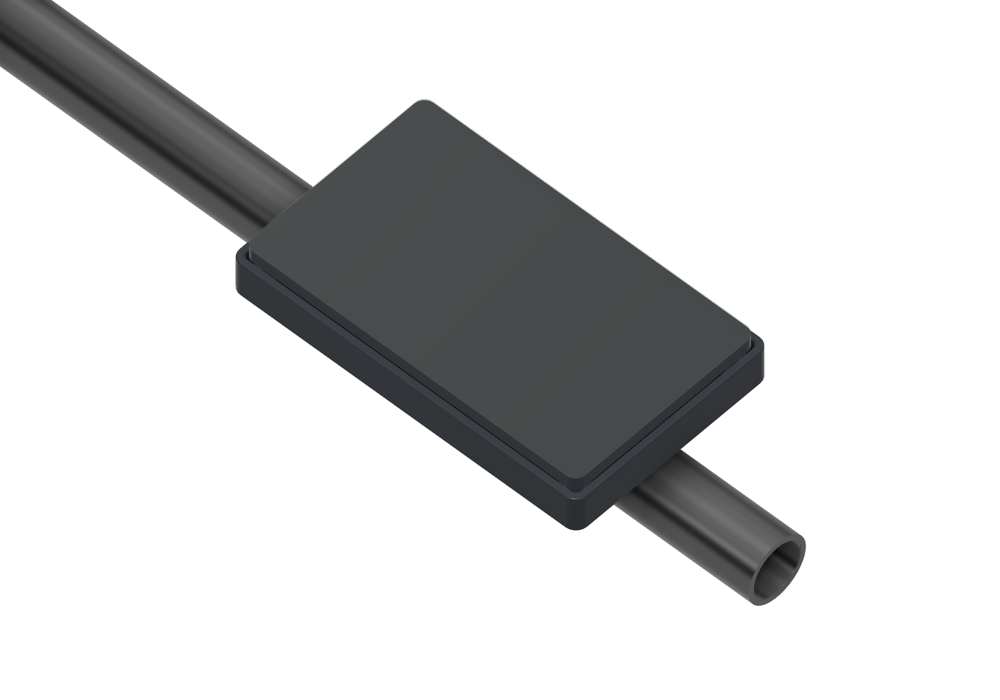

# GUITION 4.3-inch ESP32-P4 display

The `guition_jc4880p443c` target is for the GUITION **JC4880P443C_I_W** / enclosed `_Y` board, described as JC4880P433 in the original article. It has a 480 × 800 ST7701S MIPI-DSI panel, GT911 touch, 16 MB flash, 32 MB PSRAM and an ESP32-C6 radio companion.

The profile requires **production ESP32-P4 revision 3.1 or newer**; pre-v3 engineering samples are incompatible. Check the boot log or run `esptool --port YOUR_PORT chip-id` before installation.

## Install the firmware

1. Confirm your P4 revision is **3.1 or newer** using the boot log, esptool or vendor information. Do not install this firmware on pre-v3 silicon.
2. Check that the C6 has compatible radio firmware; see [ESP32-C6 radio firmware](#esp32-c6-radio-firmware) below.
3. Open the [browser installer](https://techfoundrynz.github.io/wheelie_fun_display/install/), choose **GUITION JC4880P443C** and connect to the P4 with a USB data cable.
4. Complete installation, then check the screen and touch before [connecting your bike](../GETTING-STARTED.MD).

The installer flashes the P4 application and its flash layout. It does not provision or replace the C6 firmware. A full USB installation can reset saved settings; use [on-device updates](maintenance.md) for routine maintenance.

The supplied profile starts in 90° landscape (800 × 480). Tap **Settings > Orientation** to cycle through all four angles; the choice is saved and touch rotates with the screen.

## Large-screen layout

Landscape Ride uses a full-width battery gauge at the top, then a larger speed dial on the left and trip and odometer above the four telemetry cards on the right. In portrait, telemetry cards and distance readings are larger. Stats groups its overview into three columns when the screen is wide; controller and BMS details remain scrollable.


These previews are generated from the current shared UI with illustrative connected values during the Pages build. In the [browser simulator](../simulator/), select **GUITION 4.3-inch** under **Display model**, then use Rotate to explore all four orientations.

## Case and handlebar mount



The [GUITION case and mount guide](../cad/guition-43/README.md) includes the shared editable Fusion archive, five STEP downloads, shaded views and an assembly animation. It covers the rear housing, aluminium clamp, split handlebar liner, cable grommet and additional display mounting screws. Check the real module against the CAD's explicitly unverified display-depth reference before fabrication.

## CAN breakout board

The [GUITION CAN breakout guide](../pcb/guition-43/README.md) includes the editable EasyEDA Pro project, labelled board views, schematic, connector pinouts and optional CAN firmware pin configuration. The board fits the display's expansion header and provides a CAN transceiver and six-pin vehicle connector.

## ESP32-C6 radio firmware

The P4 relies on its separate C6 chip for both Wi-Fi and Bluetooth. A working vendor Wi-Fi demo alone does not establish that the companion supports this application.

Before replacing C6 firmware, check whether the existing image supports **ESP-Hosted over SDIO, Wi-Fi and Bluetooth controller HCI**. A compatible existing image may work. The profile pins ESP-Hosted 3.1.0 and esp_wifi_remote 1.6.5; a matching 3.1.0 companion is recommended.

For companions before 2.5.2, the driver skips controller-init RPCs because Bluetooth is already enabled at startup. Vendor companion 2.3.2 passed HCI binding and a user-confirmed Wi-Fi connection with DHCP on P4 v3.2, with the host's major-version warning. Wi-Fi required the PSRAM-first allocation policy to preserve radio DMA headroom; see [the diagnostic capture](performance.md#guition-wi-fi-configuration-and-dma-headroom). Bike pairing, phone interoperability, OTA and sustained radio-load acceptance remain unvalidated.

If provisioning is needed:

1. Use Espressif’s matching [ESP-Hosted coexistence companion project](https://github.com/espressif/esp-hosted-mcu/tree/v3.1.0/examples/bluetooth/esp_hosted_nimble/bleprph_wifi_coex/cp).
2. Build for `esp32c6` with ESP-IDF 6.1. Verify SDIO and the board’s C6 wiring in menuconfig. Hosted 3.x uses the example’s `cp/` project in place of the old `slave/` project.
3. Follow the board vendor’s C6 boot-mode and programming-connector instructions. Flash through the **C6 programming connection**, not the P4 application port.
4. Test a bike BLE connection, encrypted pairing, phone connection, Wi-Fi and OTA together. Check responsiveness and the serial log for DSI underruns.

These checks require the physical board and compatible C6 firmware. See the [Hosted compatibility notes](https://github.com/espressif/esp-hosted-mcu/blob/v3.1.0/docs/migration.md) before changing an existing installation.

## Scope

Camera, audio, microSD, battery telemetry and RS-485 are not initialized by this application. Optional vehicle CAN/UART pins can be configured in the hardware profile after wiring the required interface; they are not guessed from expansion-header availability. The radio SDIO bus must remain reserved for the C6.

## Sources and notices

- [GUITION product specifications](https://www.guition.com/icms/upload/fb081940d6fc11f09850077a33e1404f/file/productmanager-productfile/5dfbe9a7c0fc44869270528bd2411b1e/Directory/JC4880P443C_I_W%20Specifications-EN-V1.0_1776241869964.pdf).
- [ESP-IDF P4 revision selection](https://github.com/espressif/esp-idf/blob/v6.1/components/esp_hw_support/port/esp32p4/Kconfig.hw_support).
- [Espressif hosted NimBLE/VHCI example](https://github.com/espressif/esp-hosted-mcu/tree/v3.1.0/examples/bluetooth/esp_hosted_nimble/bleprph_wifi_coex).
- [Espressif Hosted migration and companion compatibility](https://github.com/espressif/esp-hosted-mcu/blob/v3.1.0/docs/migration.md).
- [Espressif hosted companion project](https://github.com/espressif/esp-hosted-mcu/tree/v3.1.0/examples/bluetooth/esp_hosted_nimble/bleprph_wifi_coex/cp).
- [MIT-licensed board initialization reference](https://github.com/ultramcu/guition-jc4880p4-bsp/tree/324970bade0d1f4e52880fe8016580368bc1e06e). Its panel register table is retained with the original copyright and MIT notice in `firmware/main/boards/`; the display lifecycle and rendering integration are implemented in this project.

## Build reference

This board is included in the supported `default_envs`. To build it on its own:

```sh
pio run -e guition_jc4880p443c
```

The pinned Slint release supplies matching compiler and MCU runtime assets for ESP32-S3 and ESP32-P4. Firmware builds download and verify those assets; a local Rust runtime bootstrap is not required.

Both profiles use the common PlatformIO Espressif32 8.0.0 and ESP-IDF 6.1 pins. The P4 profile selects production silicon and its 400 MHz CPU setting. Shared settings live in `sdkconfig.defaults`; architecture-specific values live in `config/`. Managed component versions are pinned once in `firmware/main/idf_component.yml`; each chip has its own generated dependency lock.

For a published release, the [browser installer](https://techfoundrynz.github.io/wheelie_fun_display/install/) flashes the complete P4 image. It does not replace the C6 companion firmware; prepare that separately as described in [ESP32-C6 radio firmware](#esp32-c6-radio-firmware).

## Display and touch reference

| Signal | Configuration |
| --- | --- |
| Native panel | 480 × 800, RGB565, two DSI lanes |
| DSI PHY | LDO channel 3 at 2.5 V; 500 Mbit/s per lane |
| DPI pixel clock | 34 MHz |
| Horizontal timing | sync 12, back porch 42, front porch 42 |
| Vertical timing | sync 2, back porch 8, front porch 166 |
| Panel reset | GPIO5 |
| Backlight | GPIO23, LEDC brightness control |
| Touch I2C | SDA GPIO7, SCL GPIO8, 400 kHz |
| Touch reset | GPIO3 |
| Touch addressing | Probe 0x5D, then 0x14; polling without an interrupt pin |

Slint renders rotated dirty spans into internal tiles. PPA copies them into the inactive DSI framebuffer and composes page snapshots for transitions. Refresh completion gates buffer reuse, and touch coordinates follow the selected rotation. PSRAM runs at 250 MHz. See [rendering and measurements](performance.md#esp32-p4-rendering).

Both corner-safe insets are 0 px; normal layout padding remains. Page slides include the side margins while the header and navigation stay fixed. The supplied profile starts at 90° (800 × 480 landscape). `DISPLAY_ROTATION` sets the initial angle in the hardware profile; runtime selection is saved in NVS.

### P4-to-C6 wiring

| Signal | P4 GPIO / configuration |
| --- | --- |
| SDIO | Slot 1, four-bit bus, 25 MHz |
| CLK / CMD | 18 / 19 |
| D0 / D1 / D2 / D3 | 14 / 15 / 16 / 17 |
| Companion reset | 54 |

Wi-Fi uses esp_wifi_remote, and the P4 NimBLE host reaches the C6 controller through the ESP-Hosted HCI tunnel. Keep this SDIO bus reserved for the radio companion.
