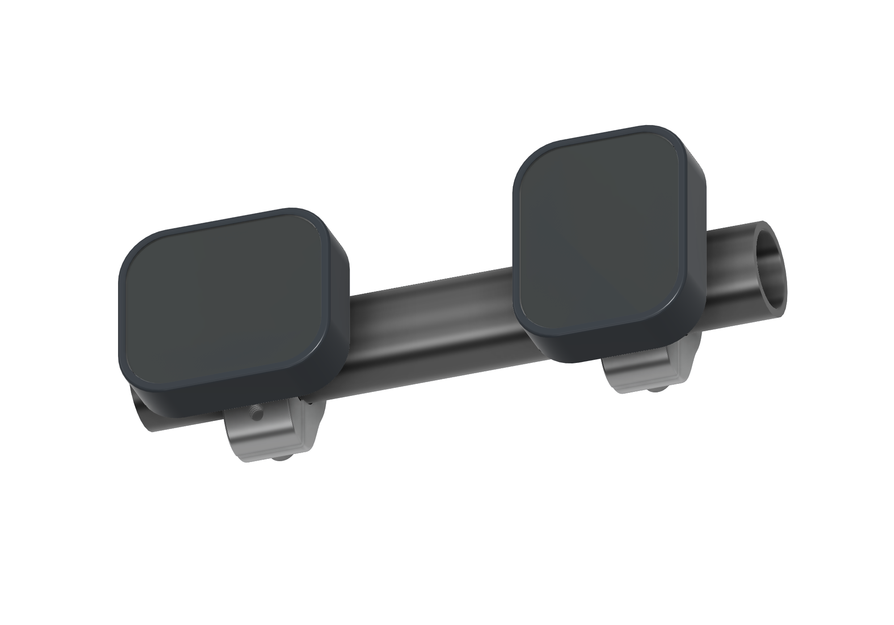

# Waveshare ESP32-S3 AMOLED 2.06-inch display

Use the `waveshare_esp32s3_206` target for the **Waveshare ESP32-S3 Touch AMOLED 2.06**. Its native resolution is 410 × 502, with a CO5300 AMOLED panel, FT3168 touch, 32 MB flash and 8 MB octal PSRAM. Wi-Fi and Bluetooth are built into the ESP32-S3; no radio companion needs provisioning.


The picture is generated from the current shared UI during the documentation build. Its connected values are illustrative.

## Install and build

Choose **Waveshare ESP32-S3 AMOLED 2.06** in the [browser firmware installer](https://techfoundrynz.github.io/wheelie_fun_display/install/), using a USB data cable. Select the exact board model rather than another Waveshare display size.

To build this target locally:

```sh
pio run -e waveshare_esp32s3_206
```

The application is `.pio/build/waveshare_esp32s3_206/firmware.bin`. Release packaging produces `waveshare_esp32s3_206.bin` for OTA and `waveshare_esp32s3_206-factory.bin` for a complete USB installation. The complete image can reset saved settings; prefer the display's Wi-Fi/OTA flow for an ordinary update.

Both supported boards use the common PlatformIO and ESP-IDF pins and the matching, checksum-verified Slint release. Shared settings are in `sdkconfig.defaults`, S3 settings in `config/sdkconfig.s3`, and board capabilities in [platformio.ini](../platformio.ini). No Rust toolchain is needed for firmware builds.

## Display, touch and orientation

The profile runs the CPU at 240 MHz, flash and octal PSRAM at 80 MHz, and the panel's QSPI interface at 80 MHz. It uses internal DMA scanline buffers for rendering, with immutable font metadata kept in flash.

CO5300 uses the managed SH8601-compatible QSPI transport with a 22-pixel column offset. FT3168 uses the compatible FT5x06 touch driver. Display and touch resets use direct GPIO control; there is no I/O expander.

The rounded panel uses a 32-pixel horizontal safe inset and a 16-pixel vertical inset (`DISPLAY_SAFE_INSET_X` / `DISPLAY_SAFE_INSET_Y`). The axes follow the logical UI in every orientation. **Settings > Orientation** cycles through 0°, 90°, 180° and 270° and saves the preference. The layout and touch transform follow the selected orientation; the native panel dimensions remain 410 × 502.

## Board wiring

These are the shipped profile's internal connections, not suggested pins for external accessories.

| Function | GPIO / value |
|---|---|
| I2C SDA / SCL | 15 / 14 |
| QSPI clock / chip select | 11 / 12 |
| QSPI data 0–3 | 4 / 5 / 6 / 7 |
| Display reset / enable | 8 / 13 |
| Touch reset / interrupt | 9 / 38 |
| Panel column offset | 22 pixels |

BLE is the default vehicle transport. CAN and UART appear in Settings only after their pin pairs are configured in the target profile. Choose available pins and provide the required external CAN transceiver or UART wiring; see [vehicle transports](transports.md).

## Case and handlebar mount



The [case and mount guide](../cad/waveshare-206/README.md) includes the editable Fusion archive and STEP downloads for the printed casing, aluminium upper saddle and lower clamp cap, plus the split rubber liner and one-piece TPU cable grommet. The [cable gland / grommet installation instructions](../cad/waveshare-206/README.md#cable-grommet-installation) cover the 6 mm cable jacket, revised 7.8 mm casing opening and fitting the grommet before terminating oversized connectors. The same casing can be rotated on the clamp for **portrait or landscape mounting** using its square mounting pattern. Set **Settings > Orientation** to match; all four UI rotations (0°, 90°, 180° and 270°) are supported. The guide also covers model dimensions, fasteners and assembly details for the nominal 22.225 mm (7/8-inch) handlebar design.

## USB recovery and checks

If the serial device is missing, hold **BOOT**, tap **RESET**, then release **BOOT**. Check the USB data cable and run `pio device list` to identify the board's current port.

After installation, confirm the dashboard, cog, Settings scrolling and touch at all four orientations. The connected S3 board has passed SDK 6.1 startup and rendering checks; real-bike, phone-proxy and OTA acceptance remain listed in [TODO](../TODO.md). Occasional touch I2C read errors are also tracked there; save the serial log when diagnosing a touch issue.

See [troubleshooting](troubleshooting.md), [performance configuration](performance.md), the [Waveshare product page](https://www.waveshare.com/esp32-s3-touch-amoled-2.06.htm) and [vendor examples](https://github.com/waveshareteam/ESP32-S3-Touch-AMOLED-2.06).
