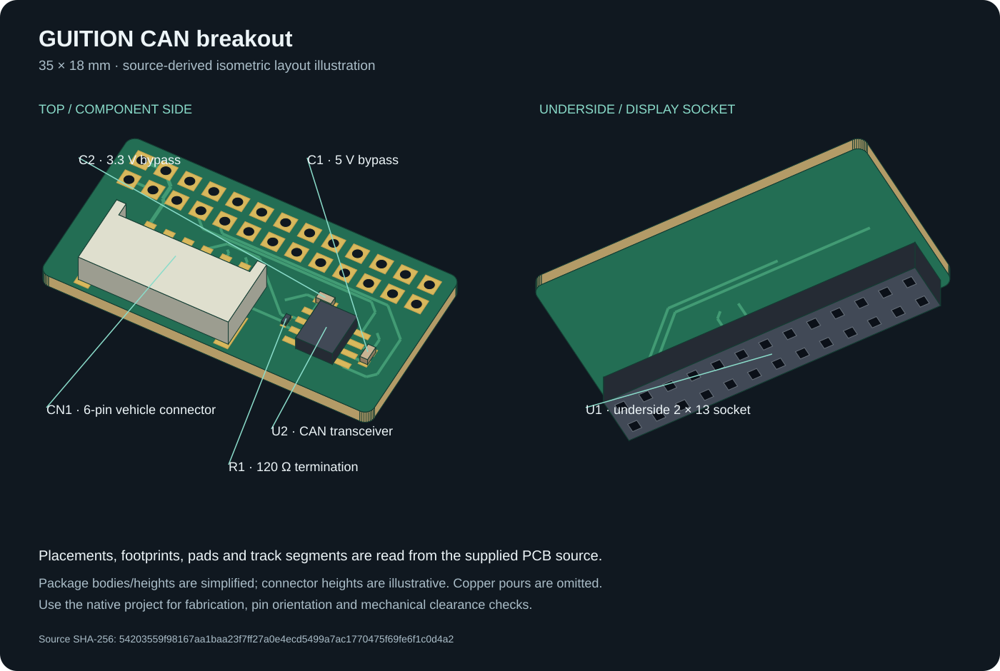
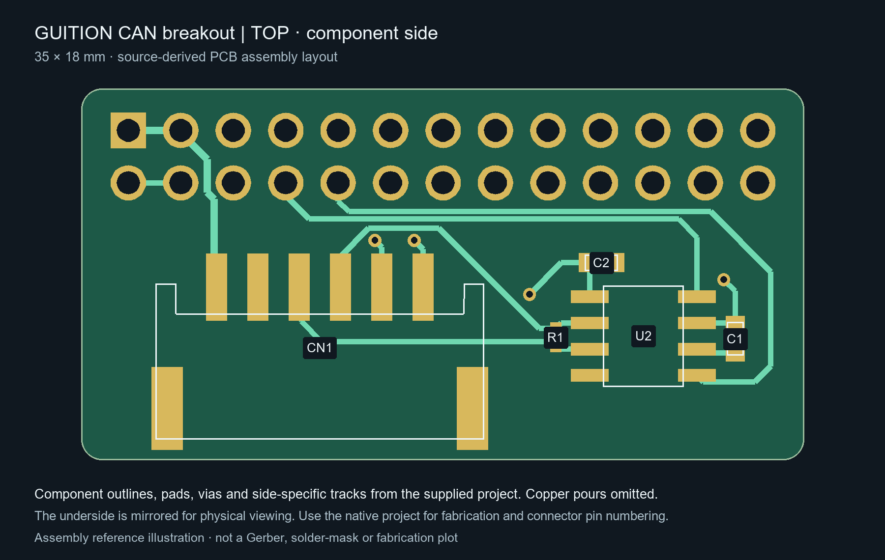
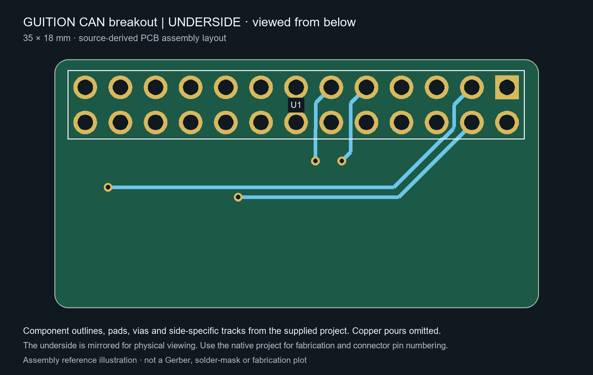
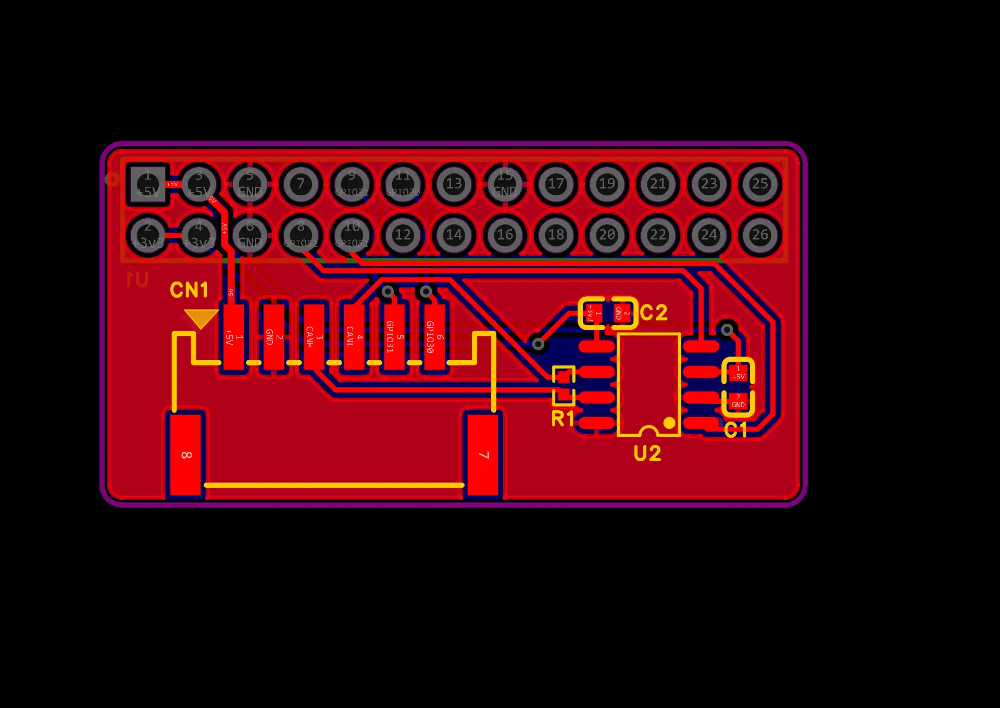
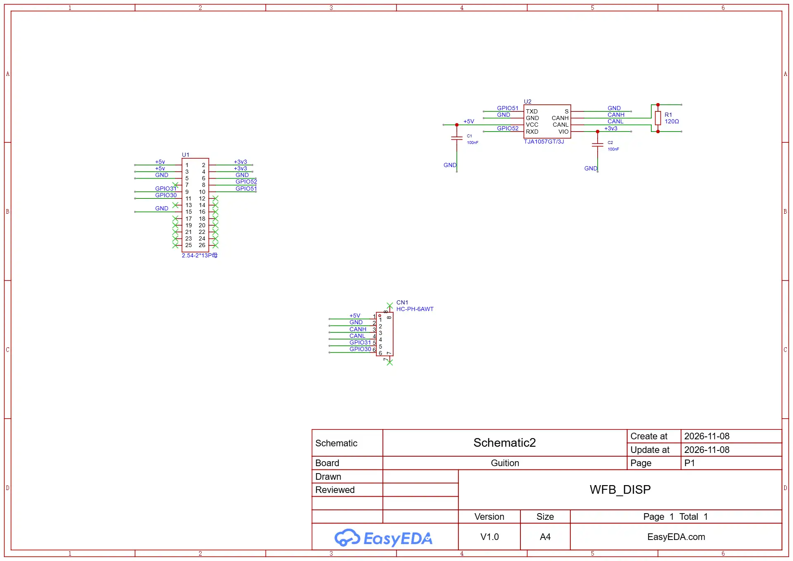

# GUITION CAN breakout board

This board adds a CAN transceiver and vehicle connector to the GUITION 4.3-inch display's expansion header. It is a separate PCB project from the [case and handlebar mount](../../cad/guition-43/README.md).

## Editable source

[Download the EasyEDA Pro project](Guition_CAN_PCB.epro2). The supplied archive records editor version **3.2.209** and includes the schematic, PCB, footprints and component metadata. Import it into EasyEDA Pro as a project archive; keep the `.epro2` extension.

The supplied layout is **35 × 18 mm**, with 1 mm corner radii and an approximately 1.6 mm two-layer stack. These details describe the supplied design, rather than a verified fabricated assembly. Gerbers, drill files and an assembly-ready manufacturing package are not included here.

## Labelled board views



This source-derived isometric illustration uses the actual board outline, placements, footprints, pads and track segments. Component bodies are simplified, connector heights are illustrative and copper pours are omitted. It is not a native vendor-model render or a mechanical clearance model. **U1 is mounted on the underside**, while the other components are on the top side.

### Top layout



### Underside layout



These side-specific assembly illustrations are generated from the source geometry. They show each side's tracks and component outlines, plus through-hole pads; copper pours are omitted. The underside is mirrored for physical viewing. Use the native project for manufacturing plots and connector pin numbering.

### Native combined-layer preview



### Schematic



## Components

| Reference | Supplied part | Function |
| --- | --- | --- |
| U1 | 2 × 13 female header, 2.54 mm pitch | Underside display expansion socket |
| CN1 | HC-PH-6AWT, six positions, 2 mm pitch | Vehicle wiring connector |
| U2 | NXP TJA1057GT/3J, SOIC-8 | CAN transceiver with 5 V supply and 3.3 V logic supply |
| R1 | 120 Ω, 0402 | CANH-to-CANL termination |
| C1 | 100 nF, 0603 | 5 V supply bypass |
| C2 | 100 nF, 0603 | 3.3 V logic supply bypass |

R1 is wired directly across CANH and CANL in this design. Populate termination according to the board's position on the bus; do not add an extra terminating resistor to an already terminated intermediate node.

## Vehicle connector CN1

| Pin | Net | Purpose |
| --- | --- | --- |
| 1 | +5V | 5 V rail |
| 2 | GND | Common ground |
| 3 | CANH | CAN high |
| 4 | CANL | CAN low |
| 5 | GPIO31 | Additional display GPIO |
| 6 | GPIO30 | Additional display GPIO |

These are the source's pin numbers. Confirm the pin-1 marker and mating-side orientation in the editor and on the actual connector before making a cable. The footprint's pads 7 and 8 are unconnected mechanical pads, not additional signal pins.

## Display socket U1

| Pin | Net | Pin | Net |
| --- | --- | --- | --- |
| 1 | +5V | 2 | +3v3 |
| 3 | +5V | 4 | +3v3 |
| 5 | GND | 6 | GND |
| 7 | Unconnected | 8 | GPIO52 / CAN RX |
| 9 | GPIO31 | 10 | GPIO51 / CAN TX |
| 11 | GPIO30 | 12 | Unconnected |
| 13 | Unconnected | 14 | Unconnected |
| 15 | GND | 16–26 | Unconnected |

Pin numbering is taken from the underside-mounted footprint. Use the native project to check which physical end is pin 1 rather than treating an underside view as a top view.

## Firmware configuration

The schematic connects U2 TXD to **GPIO51** and RXD to **GPIO52**. To enable this wiring, add these build flags to the GUITION hardware profile's existing flags:

```ini
-DCAN_TX=51
-DCAN_RX=52
```

The supplied firmware profile does not enable those pins automatically. Once configured, choose **CAN** in Settings and use a bitrate matching the vehicle; the default is 500 kbit/s. See [connections and proxy](../../docs/connections.md) for transport selection and controller discovery, and [GUITION hardware](../../docs/hardware-guition-43.md) for the rest of the board setup.
